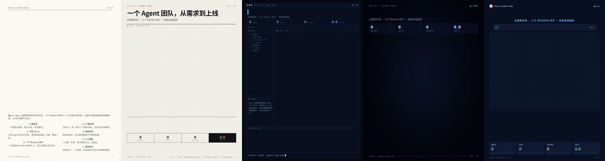
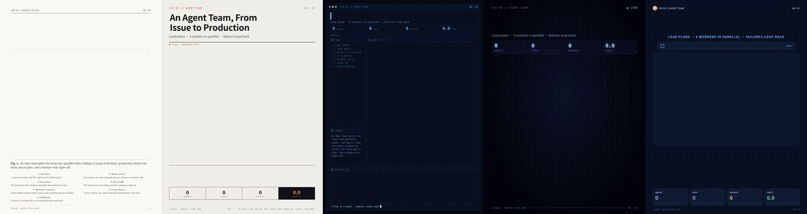

# 动态流程图视频 Skill

一个可移植的 Agent Skill：把一段流程，或一篇能画成流程图的文章，做成 3:4 竖版（1080×1440）的动态流程图视频。视频是 MP4，带 BGM，节点点亮卡在节拍上。




上图从左到右：`paper` 学术论文、`poster` 浅色技术海报、`terminal` 暗色终端、`neon` 霓虹 HUD、`product` 产品 UI。所有连线都是直角折线。

## 使用方式

把 `m-flowchart-anim/` 目录作为一个 Skill，放进你所用 Agent 宿主支持的 Skill 位置，再这样触发：

> 把这篇文章做成动态流程图视频。

Skill 会先问三件事：风格（附推荐和理由）、语言（中文或英文，默认跟原文一致）、BGM。你已经说了的就不再问。接着它会：

1. 从文章里提炼节点、连线（包括分支和回环）、讲解顺序；
2. 写成一份 JSON spec；
3. 生成单文件 HTML，截几张图自查；
4. 用无头 Chrome 逐帧录制成 MP4。

同一份 spec 每次录出来都一样。

## 四个可组合的维度

| 维度 | 选项 |
|---|---|
| 风格 | `paper` `poster` `terminal` `neon` `product` |
| 版式 | `flow` 分层流程、`hub` 中心辐射、`auto` 自动判断 |
| 动效 | 跟随风格：荧光笔逐段高亮、像素小人、打字日志、粒子与镜头推近、App 步骤面板 |
| BGM | `steady` `pulse` `drive`、任意音频文件，或 `none` |

## 需要的本机环境

- Python 3 和 [uv](https://docs.astral.sh/uv/)：录制脚本用 `uv run --with playwright` 临时装 Playwright。
- Chrome 或 Chromium。脚本找浏览器的顺序：
  1. 环境变量 `CHROME`；
  2. `/usr/bin/google-chrome`；
  3. Playwright 自带的 Chromium（需要先运行 `uv run --with playwright playwright install chromium`）。
- ffmpeg。

手动跑一遍示例：

```bash
python3 scripts/build.py examples/agent-team.zh.json --style neon -o out/flow.html
uv run -q --with playwright python scripts/record.py out/flow.html out/flow.mp4
```

## 授权

- 代码和文档采用 [MIT 许可证](LICENSE)。
- `assets/bgm/` 里的三首配乐都是 CC0 1.0（公有领域），来自 OpenGameArt，用这些曲子做出来的视频不用署名。出处见 [`assets/bgm/CREDITS.md`](assets/bgm/CREDITS.md)。
- 画面风格参考了 X 上 18 段流程图动画，归纳成六类。原视频的配乐是商业曲目，没有收录。

## 文件

| 路径 | 用途 |
|---|---|
| `SKILL.md` | 触发条件、流程、内容上限 |
| `references/spec.md` | spec 字段和时间轴规则 |
| `references/styles.md` | 各风格适合的内容、BGM 预设、怎么加新风格 |
| `assets/runtime.js` | 布局、时间轴、镜头、节拍；`render(t)` 是纯函数 |
| `assets/styles/` | 每种风格的外框和配色 |
| `assets/bgm/` | 三首 BGM 和节拍数据 |
| `scripts/build.py`、`scripts/record.py` | 生成 HTML、录制 MP4 |
| `examples/` | 示例 spec |

生成的文件写进当前任务的工作目录，不写回 Skill 目录。
